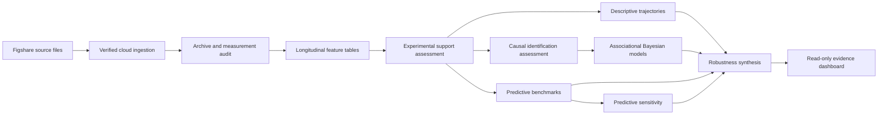

# Battery Aging Under Different Conditions

[](https://github.com/Bhavik-Patwa/Battery-Aging-Under-Different-Conditions/actions/workflows/application-quality.yaml)

A reproducible analytical system for auditing, modeling, validating and communicating lithium-ion battery-aging evidence.

The project analyzes the **Multi-Stage Lithium Ion Battery Aging Study** for Samsung INR21700-50E cells. It combines deterministic data ingestion, measurement-level quality assessment, longitudinal feature extraction, experimental-support analysis, descriptive and hierarchical modeling, predictive benchmarking, sensitivity analysis, robustness assessment and a read-only evidence dashboard.

The available evidence supports descriptive, associational and predictive reporting within observed experimental conditions. It does not establish causal treatment effects, authorize treatment optimization or justify operating-policy recommendations.

## Project objectives

The system addresses four questions :

1. What battery-aging measurements can be extracted reproducibly from the published archives?
2. Which operating-condition comparisons have adequate experimental support?
3. How accurately can relative capacity and DC internal resistance trajectories be described or predicted within observed conditions?
4. How do findings vary under alternative model families, validation partitions, observation windows, incident exclusions and predictor sets?

The cell is the independent experimental unit. Repeated measurements from the same cell are treated as longitudinal observations and are never treated as independent cells.

## Data source

- Dataset : [Multi-Stage Lithium Ion Battery Aging Study](https://doi.org/10.6084/m9.figshare.25975315.v1)
- Associated publication : [Scientific Data article](https://doi.org/10.1038/s41597-024-03859-z)
- Cell type : Samsung INR21700-50E
- Physical cells : 279
- Calendar-aging cells : 132
- Cycle-aging cells : 147
- Operating test points : 71
- Condition and testing-protocol combinations : 93
- Published files : 280, comprising experiment metadata and 279 cell archives

The source dataset is published under the [Creative Commons Attribution 4.0 International license](https://creativecommons.org/licenses/by/4.0/). This dataset license does not apply to the repository software, for which no software license is currently declared.

## Analytical scope

### Primary outcomes

- Relative capacity, normalized to each cell’s initial reference test.
- Relative uncorrected DC internal resistance, normalized to each cell’s initial reference test.

Relative capacity is derived from the mean of integrated charge and discharge capacities. Primary cycling exposure is calculated from absolute current throughput divided by twice the 4.9 Ah reference capacity. Primary DC internal resistance is calculated from the voltage change during the approximately ten-second discharge pulse.

OCV-corrected resistance is retained only as a provisional sensitivity quantity because the available OCV normalization uses sample position rather than integrated capacity.

### Observation axes

- Calendar aging : gross elapsed calendar time between reference measurements.
- Cycle aging : fully equivalent cycles or elapsed time, treated as distinct quantities.

Gross elapsed time is not interpreted as net time under an assigned storage condition.

### Reporting boundaries

The project permits :

- descriptive trajectory summaries;
- associational hierarchical trajectory summaries;
- grouped predictive-performance reporting;
- restricted robustness and sensitivity summaries; and
- reporting over observed common-support ranges.

The project does not permit :

- causal treatment-effect claims;
- discrete point contrasts without an independently justified horizon;
- extrapolation beyond observed support;
- novel-condition prediction;
- treatment optimization;
- operating-policy recommendations; or
- direct generalization to battery packs, other chemistries, other cell formats or untested operating regimes.

## System architecture



Every analytical report records its direct inputs, artifact digests, table schemas, row counts and reconciliation status. Generated evidence is validated before it is displayed.

## Principal findings

### Data quality and feature extraction

All 279 cell archives and 5,763 measurements were audited.

The source data contain several conditions that must remain visible during analysis :

- 2,462 measurements in which every sampled ambient-temperature value is non-finite;
- 1,149 companion-metadata identity mismatches;
- 205 measurements with values outside registered physical guardrails;
- 24 empty measurements;
- 24 numeric runtime representations;
- 24 step/current-direction mismatches;
- 13 invalid companion dates; and
- 2 timestamp reversals.

Raw records are not silently altered or discarded. Each warning, manual-review decision and exclusion remains connected to its source identity and reason code.

The completed feature inventory contains :

| Table | Rows |
|---|---:|
| Cell features | 279 |
| Condition features | 93 |
| Cycling-exposure features | 1,893 |
| Reference-test features | 2,766 |

The extracted longitudinal inventory includes 1,965 primary relative-capacity observations and 1,962 primary relative-resistance observations.

### Experimental support

The experimental-support inventory evaluates 13,032 candidate condition comparisons :

| Decision | Count |
|---|---:|
| Supported with restrictions | 1,004 |
| Sensitivity-only | 230 |
| Descriptive-only | 3,984 |
| Unsupported | 7,814 |

Only 210 supported or sensitivity comparisons differ in one assigned treatment. The remaining 1,024 supported or sensitivity comparisons represent differences between joint operating-condition combinations.

Important structural restrictions include :

- the treatment-assignment mechanism is not documented;
- laboratory allocation is tied to test point;
- experimental stage and batch are aliased;
- no exact treatment combination is shared across experimental stages;
- calendar-aging and cycle-aging populations require separate analysis; and
- elapsed time and fully equivalent cycles are distinct observation axes.

These restrictions prevent isolated causal treatment interpretation.

### Descriptive modeling

The deterministic descriptive inventory contains 21,168 candidates. Of these :

- 724 were fitted;
- 386 were structurally inadmissible;
- 30 had no usable fitted result; and
- 20,028 were outside the registered candidate selection.

The fitted inventory contains 502 weighted least-squares models and 222 linear mixed-effects models. Analytical qualification retained 362 fitted candidates for reporting and labelled 362 as diagnostic-only.

No discrete point contrast is reported as completed because no discrete comparison horizon is authorized. Descriptive reporting is limited to continuous trajectories over observed support.

### Associational Bayesian modeling

The hierarchical Bayesian inventory contains 198 candidates :

- 7 analytically available;
- 169 diagnostic-only; and
- 22 unavailable.

The models provide associational trajectory summaries and uncertainty estimates. They are not causal models.

The restricted availability reflects incomplete condition-level calibration, unavailable grouped validation, predictive benchmark restrictions or reference-sampler diagnostics. Prior-predictive, posterior-predictive, grouped-validation, sampler and prior-sensitivity records remain available for audit.

### Predictive benchmarking

Predictive benchmarks were evaluated for 131 selected analytical populations across three model families :

- elastic net;
- random forest; and
- gradient boosting.

This produced 393 family-specific benchmarks :

- 273 analytically available;
- 120 diagnostic-only.

Validation is grouped by cell and uses equal-cell weighting. Training and held-out cell identities do not overlap.

Among the 91 analytically available benchmarks in each model family, median held-out performance was :

| Model family | Median weighted RMSE | Median predictive R² |
|---|---:|---:|
| Elastic net | 0.00631 | 0.867 |
| Gradient boosting | 0.00515 | 0.919 |
| Random forest | 0.00462 | 0.928 |

These summaries do not establish a universally superior model. Performance depends on the analytical population, condition support and validation inventory.

Feature-importance values are inspection aids. They are not causal effects, held-out ablation estimates or directly comparable across model families.

### Sensitivity and robustness

The predictive sensitivity inventory contains 4,353 variants :

| Perturbation | Count |
|---|---:|
| Alternative grouped partitions | 786 |
| Expanded configuration search | 393 |
| Training-window restrictions | 786 |
| Documented incident exclusions | 1,209 |
| Predictor ablations | 1,179 |

Of these variants, 2,094 were analytically available, 1,231 diagnostic-only and 1,028 unavailable. Each variant changes one analytical component at a time; the inventory does not support factorial interaction claims.

The integrated robustness assessment is classified as a **restricted evidence summary**. It documents validation coverage, model-family agreement, specification sensitivity, prior sensitivity, incident sensitivity, observation-window sensitivity, unsupported conditions, external-validity limits and fragile findings.

Sixty-three Bayesian candidate identities had held-out predictions without corresponding grouped-validation metric records. Their 744 predictions are explicitly excluded from cross-framework robustness calculations.

## Repository structure

```text
.
├── configs/                         Machine-readable analytical contracts
├── dashboard/                       Read-only Streamlit evidence application
├── scripts/
│   ├── ingest_dataset.py            Verified cloud acquisition
│   ├── validate_ingested_dataset.py Landing-inventory validation
│   ├── audit_data_quality.py        Archive and measurement assessment
│   ├── extract_cell_features.py     Longitudinal feature extraction
│   ├── audit_experimental_design.py Experimental-support analysis
│   ├── assess_causal_identification.py
│   ├── run_descriptive_models.py
│   ├── run_bayesian_models.py
│   ├── run_predictive_models.py
│   ├── run_predictive_sensitivity.py
│   └── assess_robustness.py
├── tests/                           Unit, integration, artifact and UI tests
├── .github/workflows/               Quality and release automation
├── Dockerfile                       Analytical environment
├── Dockerfile.dashboard             Minimal dashboard release image
├── pyproject.toml                   Python and test configuration
└── uv.lock                          Locked dependency graph
```

Generated data and analytical artifacts are intentionally kept outside source control.

## Environment

Requirements :

- Python 3.11
- `uv`
- Docker for container verification
- Google Cloud access for source acquisition or archived production evidence

### Devcontainer credential prerequisite

The devcontainer mounts the local Google Cloud Application Default Credentials file as read-only. Create that file before opening the repository in the devcontainer:

```bash
gcloud auth application-default login
```

This credential is required for the configured devcontainer mount and cloud-backed acquisition workflows. Running the dashboard directly against existing validated artifacts does not otherwise require Google Cloud credentials.

Install the locked environment :

```bash
uv sync --frozen --all-groups --no-install-project
```

Validate the lock :

```bash
uv lock --check
```

Run self-contained tests :

```bash
.venv/bin/python -m pytest -q -m "not production_artifacts"
```

Run the complete suite when validated artifacts are present under `data/processed` :

```bash
.venv/bin/python -m pytest -q
```

A complete full-workspace verification with the validated generated artifacts present produced 836 passing tests. The artifact-independent selection contains 822 passing tests, while 14 explicitly marked tests require the validated artifacts under `data/processed`. The full-suite count must be regenerated whenever tests or registered artifacts change.

## Analytical execution

Each command exposes its complete interface through `--help` :

```bash
.venv/bin/python -m scripts.ingest_dataset --help
.venv/bin/python -m scripts.validate_ingested_dataset --help
.venv/bin/python -m scripts.audit_data_quality --help
.venv/bin/python -m scripts.extract_cell_features --help
.venv/bin/python -m scripts.audit_experimental_design --help
.venv/bin/python -m scripts.assess_causal_identification --help
.venv/bin/python -m scripts.run_descriptive_models --help
.venv/bin/python -m scripts.run_bayesian_models --help
.venv/bin/python -m scripts.run_predictive_models --help
.venv/bin/python -m scripts.run_predictive_sensitivity --help
.venv/bin/python -m scripts.assess_robustness --help
```

Run commands against pinned inputs and machine-readable contracts. Do not replace registered inputs, thresholds, model inventories or support definitions without producing a separately identified analysis.

Bayesian posterior artifacts and predictive sensitivity calculations are computationally substantial. Existing validated caches should be preserved and verified rather than recreated unnecessarily.

## Evidence dashboard

Validate the complete evidence inventory :

```bash
.venv/bin/python -m dashboard.healthcheck \
  --artifact-root data/processed \
  --policy-path configs/evidence_dashboard_policy.json
```

Run the application locally :

```bash
EVIDENCE_ARTIFACT_ROOT=data/processed \
EVIDENCE_DASHBOARD_POLICY=configs/evidence_dashboard_policy.json \
.venv/bin/streamlit run dashboard/app.py
```

The dashboard provides six views :

1. Evidence boundaries
2. Experimental support
3. Trajectories
4. Predictive evidence
5. Robustness
6. Provenance

It does not fit models or modify evidence. Startup is refused when required reports or tables are missing or fail digest, schema or row-count validation.

## Release container

Build the dashboard image with source and evidence metadata :

```bash
source_revision="$(git rev-parse HEAD)"
policy_sha256="$(.venv/bin/python -c "import hashlib; from pathlib import Path; print(hashlib.sha256(Path('configs/evidence_dashboard_policy.json').read_bytes()).hexdigest())")"

docker build \
  --file Dockerfile.dashboard \
  --build-arg SOURCE_REVISION="$source_revision" \
  --build-arg SOURCE_URL="https://github.com/Bhavik-Patwa/Battery-Aging-Under-Different-Conditions" \
  --build-arg EVIDENCE_POLICY_SHA256="$policy_sha256" \
  --tag battery-aging-evidence-dashboard:local \
  .
```

Run the image with a read-only evidence mount :

```bash
docker run --rm \
  --publish 127.0.0.1:8501:8501 \
  --mount type=bind,source="$(pwd)/data/processed",target=/artifacts,readonly \
  battery-aging-evidence-dashboard:local
```

Each protected release publishes the tested image under an immutable commit-specific tag and records its registry digest in a machine-readable release manifest. The authoritative manifest for a source commit is stored at:

```text
gs://battery-aging-artifacts/evidence_dashboard/releases/<source-commit>/release_manifest.json
```

The manifest binds the source commit and archive, repository-relative source-file manifest, evidence bundle, dashboard policy, vulnerability assessment, scanned image identity, published image identity and immutable registry digest.

The source documentation intentionally does not designate a mutable `latest` image or embed the digest generated from its own commit. Changing a source document changes the source commit and therefore changes the resulting image digest. Previously published digests remain valid historical artifacts rather than mutable pointers.

Released images run as a non-root user, contain no analytical artifacts and require evidence to be mounted read-only. Publication is blocked by every critical vulnerability and every high-severity vulnerability for which the scanner reports an available package fix. Residual findings without an available fix remain preserved for deployment-specific review.

## Reproducibility and provenance

The implementation provides :

- pinned dataset identity and remote-file inventory;
- source size and checksum verification;
- content-addressed analytical reports;
- table-level SHA-256 digests;
- deterministic row ordering and serialization;
- grouped validation by independent cell;
- explicit unavailable and diagnostic-only results;
- transactionally published output directories;
- byte-identical reproduction checks for generated analytical output directories (release evidence bundles are validated through exact bundle hashes and member-level manifests; equivalent packaging runs are not claimed to produce byte-identical archive containers);
- immutable container references;
- source and evidence manifests; and
- vulnerability records bound to the released image identity.

The read-only evidence application validates eight reports and fifteen displayed tables before rendering.

## Interpretation

The strongest project result is not an optimized battery policy. It is a reproducible account of what the dataset can and cannot support.

Within observed populations, several predictive models provide useful held-out accuracy. However, experimental allocation, support overlap, calibration coverage, incident provenance and validation availability limit causal interpretation and broad transportability.

The results should therefore be used to understand observed degradation trajectories, compare predictive approaches, identify evidence gaps and guide future experimental design—not to prescribe battery operating conditions.

## Scientific report

A formal methods and findings report is available in [`docs/SCIENTIFIC_REPORT.md`](docs/SCIENTIFIC_REPORT.md).

## Citation and attribution

When using this repository, cite both the source dataset and its associated publication :

- Multi-Stage Lithium Ion Battery Aging Study. Figshare. <https://doi.org/10.6084/m9.figshare.25975315.v1>
- Stroebl, F., Petersohn, R., Schricker, B., Schaeufl, F., Bohlen, O., & Palm, H. "A multi-stage lithium-ion battery aging dataset using various experimental design methodologies." *Scientific Data* 11, 1020 (2024). <https://doi.org/10.1038/s41597-024-03859-z>

Repository-specific citation metadata may be added once an archival repository release and persistent identifier are available.

No software license is currently declared. No `LICENSE` file is present and the Docker image does not carry an OCI license label. Absent an explicit license, default copyright applies : the code may be viewed but not reused, modified or redistributed without the author's permission. Do not treat the repository as open-source.
